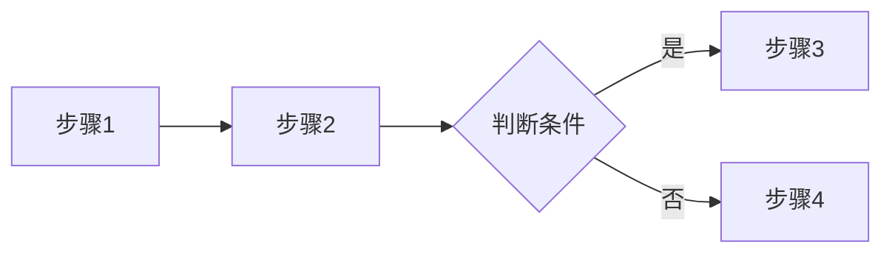
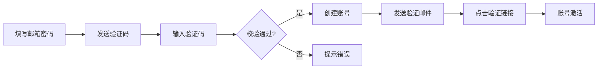

# PRD 模板

> 本模板定义了 requirement-analysis skill 生成 PRD.md 的标准格式。
> 生成 PRD 时应严格遵循此模板的章节结构和格式规范。

---

## 截图拼接页标识

解析时若检测到页面由多张截图拼出来（`is_screenshot_composite=true`），在 PRD 的页面清单/功能需求/数据字段章节中，该页面名称后必须加标识：

```
1. [页面名称] 🖼️拼接截图 - [页面用途]
```

并在"附录 → 待补充项"中注明：

```
- [页面名称]：检测到截图拼接（[screenshot_evidence]），页面内容为图片拼接，无法提取字段/控件，需提供可编辑原型或单独的设计源文件。
```

---

## 页面分类

每个页面在 PRD 中必须标注 `page_category`，分类包括但不限于：

| 分类 | 含义 |
|------|------|
| `admin_console` | 管理后台页面 |
| `config_page` | 配置页 |
| `mobile_page` | 移动端页面 |
| `flow_diagram` | 流程图 / 拓扑图 |
| `login_page` | 登录 / 注册 / 验证码页 |
| `list_page` | 列表页 |
| `detail_page` | 详情页 |
| `form_page` | 表单页 |
| `modal_dialog` | 弹窗 / 对话框 |
| `dashboard` | 仪表盘 / 数据看板 |
| `image_composite` | 截图拼接页 |
| `unknown` | 无法判定 |

在"页面结构 → 页面清单"中标注分类：

```
1. [页面名称] [page_category] - [页面用途]
```

---

## 字段说明规则（禁止臆想）

生成"字段说明"和"数据字段"章节时，严格遵循：

1. **字段来源**：字段标签必须来源于页面 `texts`（原型中实际出现的文字），禁止凭空臆想。
2. **字段类型**：从页面控件推断（下拉/输入框/日期/单选/复选）；控件对应不上时标"待确认"。
3. **必填/默认值/校验规则**：原型未明确显示时，一律标"待确认"，不得凭空臆想。
4. **英文字段名（name）**：不臆想，留空待用户/后端确认。
5. **模糊字段**：归入 `ambiguous_fields`，**必须先与用户确认后再写入 PRD**。确认前在"附录 → 待确认事项"中列出。

字段说明表格式：

| 字段名 | 中文名 | 类型 | 必填 | 默认值 | 说明 |
|--------|--------|------|------|--------|------|
| (待确认) | 客户名称 | 输入框(input) | 待确认 | 待确认 | 字段标签来源于页面文本 |

---

## 后台管理页面筛选区域说明

`page_category=admin_console` 的页面，若解析识别到筛选区域（`filter_area.has_filter=true`），PRD 必须包含"筛选区域"小节：

```markdown
### 筛选区域

**筛选条件**

| 筛选字段 | 控件类型 | 必填 | 默认值 | 说明 |
|----------|----------|------|--------|------|
| [label] | [control_type，待确认时不臆想] | 待确认 | 待确认 | 从页面文本提取 |

**筛选操作按钮**

- [filter_actions 列表]

**说明**：筛选字段的控件类型/必填/默认值若原型未明确显示，标"待确认"，需对照原型或与用户确认后再补充。
```

---

# [项目名称] 产品需求文档

> 版本: v1.0.0 | 更新日期: YYYY-MM-DD
> 文档来源: [来源文件列表]

---

## 需求概述

### 背景

[简述项目背景和要解决的问题，2-3 句话]

### 目标用户

- [用户角色 1]
- [用户角色 2]

### 核心目标

- [目标 1]
- [目标 2]

---

## 功能清单

> 以下为原子级功能定义，每个功能细化到字段、按钮逻辑和交互说明。

### 模块 1: [模块名称]

---

#### F-[编号] [功能名称]

**基本信息**

| 属性 | 值 |
|------|-----|
| 所属模块 | [模块名称] |
| 优先级 | 高/中/低 |
| 页面 | [页面名称] |
| 操作角色 | [用户角色] |

**功能描述**

[1-2 句话描述功能目的和使用场景]

**截图**（如有，紧随功能描述）


> [截图说明：标注该截图对应的功能状态/页面，如"注册页默认态"]

**相关页面**（如有，放入原型页面截图）

- **[页面名称]**
  
  > [页面说明：该页面承载的功能/入口/状态，如"原型-注册页，含邮箱校验交互"]

> **截图来源说明**：本 skill 解析 Axure 原型生成 PRD 时，「相关页面」放原型页面截图（截图文件存放在 `output/screenshots/` 或 `output/prototype/`，PRD 中用相对路径引用）；「截图」放用户另行提供的现状界面截图（如有）。两个小节均仅在对应素材存在时输出，无素材则省略。

**字段说明**

| 字段名 | 类型 | 必填 | 校验规则 | 默认值 | 说明 |
|--------|------|------|----------|--------|------|
| field_name | string/integer/number/boolean/datetime | 是/否 | [校验规则] | [默认值] | [字段说明] |

**按钮/操作逻辑**

| 按钮/操作 | 触发条件 | 操作行为 | 异常处理 |
|-----------|----------|----------|----------|
| [按钮名称] | [点击前置条件] | [点击后执行的操作] | [异常时的提示或处理] |

**交互说明**

- [交互细节 1：输入校验时机、提示位置]
- [交互细节 2：状态切换、动画效果]
- [交互细节 3：成功/失败的反馈方式]

**验收标准**

- [ ] [可测试的验收条件 1]
- [ ] [可测试的验收条件 2]
- [ ] [可测试的验收条件 3]

**业务流程**（如涉及多步骤流程则填写）

> 流程概述：[一句话描述完整流程]



---

### 模块 2: [模块名称]

[同上格式，每个功能重复上述结构]

---

## 页面结构

### 页面清单

1. [页面名称] - [页面用途]
2. [页面名称] - [页面用途]

### 页面关系图

```
[页面A] ──> [页面B]
   │
[页面C] ──┘
```

---

## 数据字段

### 实体 1: [实体名称] ([EntityName])

| 字段名 | 类型 | 必填 | 说明 | 来源文档 |
|--------|------|------|------|----------|
| field_name | string | 是 | 字段说明 | 来源.xlsx |
| created_at | datetime | 是 | 创建时间 | 系统生成 |

### 实体 2: [实体名称]

[同上格式]

---

## 附录

### 变更历史

| 版本 | 日期 | 变更内容 | 变更人 |
|------|------|----------|--------|
| v1.0.0 | YYYY-MM-DD | 初始版本 | - |

### 待确认事项

#### 冲突项

- **[功能名称]** 的 "[字段名]" 存在冲突:
  - [来源1]: "[值1]"
  - [来源2]: "[值2]"

#### 待补充项

- [功能名称]: [缺失信息描述]

### 需求质量评估

| 功能项 | 独立性 | 可协商性 | 价值 | 可估算 | 小巧 | 可测试 | 总分 |
|--------|--------|----------|------|--------|------|--------|------|
| [功能] | ★★★ | ★★☆ | ★★★ | ★★★ | ★★★ | ★★☆ | 16/18 |

**总体建议**:
- 🟡 [需要改进的功能] - [建议]
- 🟢 [质量良好的功能]

---

## 完整示例

> 以下是一个填充完毕的 PRD 示例，供生成时参考。

```markdown
# 用户管理系统 产品需求文档
> 版本: v1.0.0 | 更新日期: 2026-04-09
> 文档来源: 需求.md, 功能清单.xlsx

## 需求概述
### 背景
本系统为电商平台提供用户账号管理能力，支持用户注册、登录、信息维护。

### 目标用户
- 普通用户（前台消费者）
- 管理员（后台运营）

### 核心目标
- 提供便捷的注册登录体验
- 保障账号安全

## 功能清单

### 模块 1: 用户管理

---

#### F-001 用户注册

**基本信息**

| 属性 | 值 |
|------|-----|
| 所属模块 | 用户管理 |
| 优先级 | 高 |
| 页面 | 注册页 |
| 操作角色 | 普通用户 |

**功能描述**
用户通过邮箱注册账号，注册后需验证邮箱才能登录。

**截图**（如有）


> 注册页默认态：邮箱/密码/确认密码三个输入项，注册按钮初始置灰

**相关页面**（如有）

- **注册页**
  
  > 原型页面：承载邮箱校验、验证码发送交互，入口为登录页"立即注册"链接

**字段说明**

| 字段名 | 类型 | 必填 | 校验规则 | 默认值 | 说明 |
|--------|------|------|----------|--------|------|
| email | string | 是 | 邮箱格式，唯一 | - | 登录账号 |
| password | string | 是 | 8位以上，含字母+数字 | - | 存储为哈希 |
| confirm_password | string | 是 | 与 password 一致 | - | 确认密码 |

**按钮/操作逻辑**

| 按钮/操作 | 触发条件 | 操作行为 | 异常处理 |
|-----------|----------|----------|----------|
| 发送验证码 | email 填写且格式正确 | 发送6位验证码，60秒倒计时 | 格式错误提示"请输入正确邮箱" |
| 注册 | 所有必填字段通过校验 | 创建账号→发送验证邮件→跳转登录页 | 邮箱已存在提示"该邮箱已注册" |

**交互说明**
- 邮箱输入框失焦时实时校验格式
- 密码强度实时显示（弱/中/强）
- 注册成功后 Toast "注册成功，请查收验证邮件"

**验收标准**
- [ ] 输入合法邮箱可成功注册
- [ ] 重复邮箱提示错误
- [ ] 密码不符合规则时注册按钮置灰

**业务流程**

> 流程概述：用户填写邮箱和密码 → 点击发送验证码 → 输入验证码 → 提交注册 → 系统创建账号 → 发送验证邮件 → 用户点击验证链接 → 账号激活



---

#### F-002 用户登录

**基本信息**

| 属性 | 值 |
|------|-----|
| 所属模块 | 用户管理 |
| 优先级 | 高 |
| 页面 | 登录页 |
| 操作角色 | 普通用户、管理员 |

**功能描述**
用户通过邮箱和密码登录系统，支持记住登录状态。

**字段说明**

| 字段名 | 类型 | 必填 | 校验规则 | 默认值 | 说明 |
|--------|------|------|----------|--------|------|
| email | string | 是 | 邮箱格式 | - | 登录账号 |
| password | string | 是 | 非空 | - | 登录密码 |
| remember_me | boolean | 否 | - | false | 记住登录30天 |

**按钮/操作逻辑**

| 按钮/操作 | 触发条件 | 操作行为 | 异常处理 |
|-----------|----------|----------|----------|
| 登录 | email 和 password 均已填写 | 验证账号密码→跳转首页 | 账号不存在提示"账号不存在"；密码错误提示"密码错误"；连续5次错误锁定15分钟 |
| 忘记密码 | 无 | 跳转密码重置页 | - |

**交互说明**
- 密码输入框默认隐藏，点击眼睛图标切换
- 登录失败后输入框抖动提示
- 支持回车键提交

**验收标准**
- [ ] 正确账号密码可登录
- [ ] 密码错误提示明确
- [ ] 连续5次错误账号锁定
- [ ] 记住登录30天内免登录

---

## 页面结构
### 页面清单
1. 注册页 - 用户注册
2. 登录页 - 用户登录
3. 首页 - 系统首页

### 页面关系图
```
登录页 ──> 首页
   │
注册页 ──┘
```

## 数据字段
### 实体 1: 用户 (User)
| 字段名 | 类型 | 必填 | 说明 | 来源文档 |
|--------|------|------|------|----------|
| id | uuid | 是 | 主键 | 系统生成 |
| email | string | 是 | 邮箱，唯一 | 数据字典.xlsx |
| password_hash | string | 是 | 密码哈希 | 数据字典.xlsx |
| status | string | 是 | active/inactive/banned | 数据字典.xlsx |

## 附录
### 变更历史
| 版本 | 日期 | 变更内容 | 变更人 |
|------|------|----------|--------|
| v1.0.0 | 2026-04-09 | 初始版本 | - |
```
