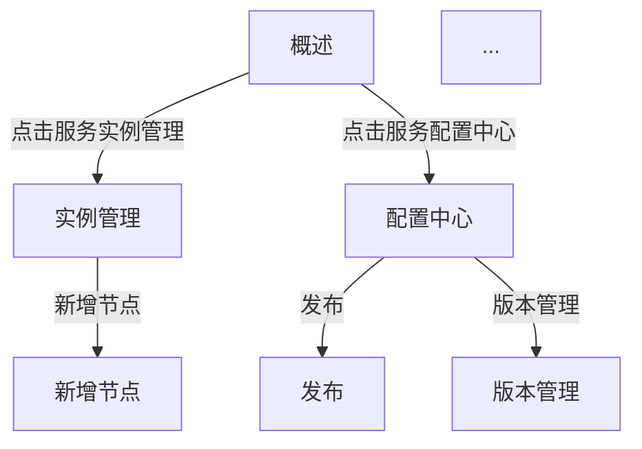

# 页面跳转关系图（md 格式）生成规范

本文件指导如何从原型解析数据生成页面跳转关系图 Markdown 文件。当用户要求生成"页面跳转关系图"/"页面导航关系"/"页面流转图"时读取本文件。

## 输出文件

- 文件名：`页面跳转关系图.md`
- 位置：原型目录下 `_output/` 或用户指定位置
- 格式：Markdown（`.md`），含 Mermaid 流程图代码块

## 文档结构

```markdown
# [项目名称] - 页面跳转关系图

## 1. 文档信息
- 版本：v1.0
- 日期：YYYY-MM-DD
- 数据来源：原型解析（工具类型标注）

## 2. 页面总览
所有页面清单 + 是否含交互事件

## 3. 跳转关系图（Mermaid）
完整页面跳转关系图

## 4. 跳转关系详表
按页面组织的跳转明细

## 5. 孤立页面
无跳转关系的页面清单

## 6. 数据来源说明
```

## 页面总览表

| 页面名 | 文件 | 含交互事件 | 跳转目标数 |
|--------|------|-----------|-----------|
| 概述 | 概述.html | 是 | 3 |
| 实例管理 | 实例管理.html | 是 | 1 |

## Mermaid 跳转关系图



**Mermaid 语法要点**：
- `graph TD` 自上而下布局（页面多时改 `graph LR` 左右布局）
- 节点格式：`ID[页面名]`，ID 用拼音或字母缩写避免冲突
- 边标签：`-->|跳转条件|目标`，条件取自按钮/链接文字或 onClick 描述
- 孤立页面单独画为无连接节点
- 同一页面有多个出口时分别画边

## 跳转关系详表

按页面分组，每页面列出其所有跳转出口：

### [页面 A]

| 出口控件 | 控件类型 | 跳转条件 | 目标页面 | 备注 |
|---------|---------|---------|---------|------|
| "服务实例管理"链接 | 链接 | 点击 | 实例管理 | - |
| "新增节点"按钮 | 按钮 | onClick | 新增节点 | 表单提交成功后跳转 |

### [页面 B]
...

## 孤立页面清单

无任何出口和入口的页面：

| 页面名 | 可能原因 | 建议 |
|--------|---------|------|
| 概览 | 原型中为独立展示页 | 补充跳转关系或确认为独立页 |
| 仅备份 | 文件夹节点 | 非功能页面，可忽略 |

## 跳转关系推断规则

1. **onClick 事件优先**：`data.js` 中的 `onClick` 交互事件是最可靠的跳转来源
2. **按钮文字推断**：含"新增/编辑/详情/发布/返回"等动词的按钮通常跳转到对应页面
3. **链接 href 推断**：HTML 中 `<a href="xxx.html">` 直接为目标页面
4. **页面名推断**：页面名含"新增/详情/发布"等动词的，通常从其主体页面（去掉动词后）可跳转
5. **树形节点推断**：树形导航的节点点击通常跳转到对应详情页

## 便签/备注说明的纳入

原型解析数据中每页的 `notes` 字段应：

- **补入跳转条件**：若备注说明的是跳转前置条件（如"登录后才能跳转"→ 边标签补"需登录"）
- **补入跳转备注列**：约束类说明填入详表的"备注"列
- **识别孤立页面原因**：备注说明中含"独立展示/静态说明"的页面归入孤立页面清单
- **补充跳转限制**：备注中提到的跳转限制（如"跨 VLAN 不可跳转"）作为边的条件标注

在文档末尾的"数据来源说明"标注：便签/矩形内备注说明已纳入跳转条件与备注列。

## 生成代码模板

## 生成脚本

**对应脚本**：`scripts/generate_page_flow.py`（可独立执行）。

**用法**：
```bash
# 先用 parse_axure.py 拿到解析 JSON
python3 scripts/parse_axure.py <原型目录> --json > prototype.json

# 再跑生成脚本
python3 scripts/generate_page_flow.py prototype.json [输出路径]
```

脚本会按本文件的列定义/分组/便签纳入规则生成 `页面跳转关系图.md`。若需调整推断逻辑，直接编辑该脚本对应函数。

## 使用要点

1. **Mermaid 节点 ID 短化**：避免页面名含特殊字符导致 Mermaid 解析失败
2. **布局方向自适应**：页面 ≤10 用 TD（上下），>10 用 LR（左右）
3. **边标签简短**：跳转条件限 20 字内，避免边过长
4. **孤立页面诚实标注**：不编造跳转关系，原型未定义的标为孤立
5. **备注说明优先**：`notes` 字段补入跳转条件和备注列
6. **多种跳转来源合并**：onClick + 按钮 + 链接 + 推断，去重保留最可靠来源
7. **标注推断来源**：从按钮文字/页面名推断的跳转在详表"控件类型"列标"推断"
